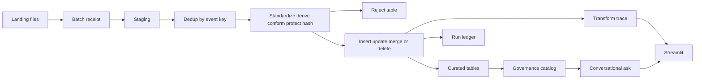
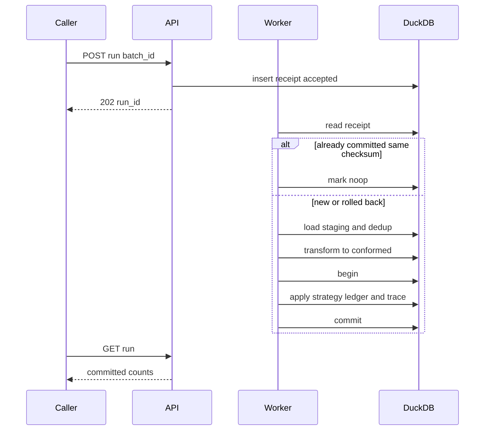
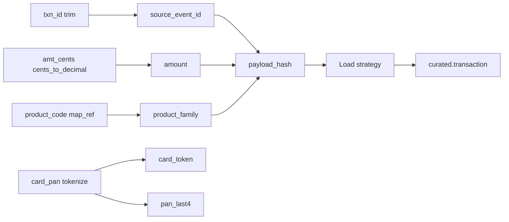
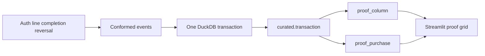
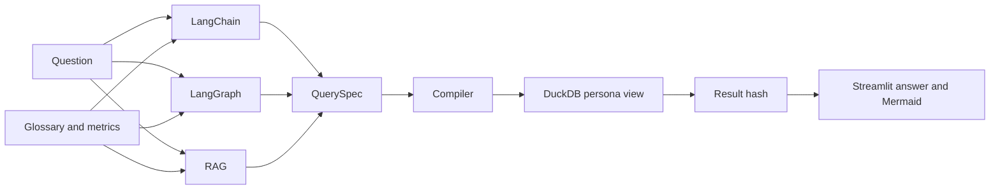

# DESIGN.md

Working spec for the AI-native interview. The problem statement in section 1 is the base contract and stays unchanged. Sections 2–10 are the filled design for this session: a DuckDB batch pipeline over synthetic WEX data, plus a governed conversational layer.

Duration target: about 45 minutes.

| Step | Time | What this file already holds |
| --- | --- | --- |
| 1. Clarify and restate | 5–10 min | Sections 2–5 |
| 2. High-level design | 5–10 min | Sections 6–8 |
| 3. Implementation and tests | 20–30 min | Section 9, then code and tests |
| 4. Quick walkthrough | 3–5 min | Section 10 |

---

## 1. Problem statement (as given)

We are building a next-gen Data Pipeline Builder. Pick and choose the runtime engine (SQL or Spark or DuckDB), but do not use existing pipeline frameworks like dbt or others. Formulate a strategy for how the pipeline should work. Call out the role that metadata will play along with how the builder will handle loading strategies like insert, update, merge and delete. Make explicit choices on the data scale, support for batch only or real-time streaming.

---

## 2. Problem restatement

**In my own words:**

Build a small pipeline runner, not a dbt-style framework, that loads synthetic WEX business data into DuckDB with batch jobs only. Each pipeline declares the transforms that turn a landing row into a curated row, then a load strategy of insert, update, merge, or delete. A run keeps a column-level trace so a person can see how each source field became the target field. Metadata defines the pipeline, the run, the lineage, and a governance catalog that classifies columns under a PII standard and masks them per persona. A retry of the same batch must not duplicate rows, drop rows, or leave a partial load. Conversational analytics sits on the curated tables: LangChain, LangGraph, and a RAG engine all answer from the same governed catalog, and Streamlit draws those flows as Mermaid diagrams. The pipeline still runs without the chat UI.

**Decisions made:**

- Runtime engine: **DuckDB**. SQL strategies run in-process. Spark is unnecessary at this scale on one machine, and a general SQL warehouse would add a service the exercise does not need.
- Data scale: **at least 6,000,000 transaction events**, plus smaller dimension, benefits, and payments tables. Target file is one local DuckDB database.
- Execution mode: **batch only**. No streaming, no micro-batches, no continuous ingestion.
- Loading strategies: **insert, update, merge, and delete**, all idempotent. Each strategy writes the **conformed** row, after a fixed transform sequence.
- Transformations: a closed set of steps in the spec (standardize, derive, conform, protect, hash). The same source row always produces the same target row. Raw card, SSN, and account numbers are replaced before anything is stored.
- Delivery: **at-least-once**. The same batch may be submitted more than once. Dedup keys and idempotent SQL make a second apply a no-op, so the stored result stays consistent and nothing already landed is lost.
- Role of metadata: pipeline spec, batch ledger, column classification, persona policy, and lineage. The runner does not hard-code table lists or mask rules.

**Clarifying questions and the decisions used:**

| # | Question | Answer / decision |
| --- | --- | --- |
| 1 | Which engine? | DuckDB. |
| 2 | What business data? | Synthetic WEX-style data: fleet fuel cards, employee benefits (HSA/FSA/COBRA), and business payments (virtual card and ACH). Invented names and numbers. Seed 42. |
| 3 | Batch or streaming? | Batch only. |
| 4 | How big? | Minimum 6,000,000 transaction rows. |
| 5 | What happens on retry? | At-least-once delivery, deduplicated and idempotent, with no lost rows and no partial commit. |
| 6 | Who can see which columns? | Data Steward, Data Engineer, Business Analyst, Product Manager. Classification follows a PII standard. |
| 7 | Does the chat layer replace the pipeline? | No. The base builder loads data on its own. Analytics is a read-only layer on top. |

---

## 3. Use cases and non-goals (45-minute version)

### In scope

| ID | Use case | Actor | Outcome |
| --- | --- | --- | --- |
| UC-1 | Register a pipeline from a spec | Data Engineer | Metadata stores engine, source, target, transforms, keys, and load strategy. |
| UC-2 | Run a batch load | Data Engineer | One batch commits fully or not at all. Run ledger records counts and status. |
| UC-3 | Retry the same batch | Data Engineer | Duplicate source rows collapse. A committed batch returns the original result and does not change totals. |
| UC-4 | Insert, update, merge, delete | Data Engineer | Each strategy has a defined match rule and writes the conformed row. Delete keeps history so the prior image is recoverable. |
| UC-9 | Show source-to-target transformation | Data Engineer, Data Steward | A run shows the steps, the column map, a masked before/after sample, and a Mermaid path from landing field to curated field. |
| UC-10 | Commit a complex purchase and prove it in DuckDB | Data Engineer | Auth, line, completion, and reversal for one purchase commit together. A DuckDB proof query shows each transform and the net amount. |
| UC-5 | Browse the governance catalog | Data Steward | Assets, columns, owners, classifications, lineage, and quality rules are visible. |
| UC-6 | Ask a question in plain language | Business Analyst, Product Manager | One engine path returns a sentence, a bounded table, and a Mermaid lineage diagram. The number matches the other engines. |
| UC-7 | Open the same question as another persona | Any persona | Restricted columns are masked or removed. The API applies the policy. The UI does not. |
| UC-8 | Check system health | Any operator | `GET /health` and `GET /ready` return a few bytes and do not scan the fact table. |

### Out of scope / non-goals

- Streaming, CDC, and near-real-time triggers.
- dbt, Airflow, Dagster, Spark jobs, or any other pipeline framework.
- Real WEX customer data, live card numbers, or production credentials.
- LLM-written SQL and LLM-made business decisions.
- Row-level security beyond the four personas, SSO, and multi-node DuckDB.
- Forecasting, write-back from the chat UI, and a vector database service.

### Assumptions and shortcuts

- One writer at a time against the DuckDB file. A second run for the same pipeline waits or returns "busy".
- Batch identity is `(pipeline_name, batch_id)` plus a SHA-256 of the source file. The same id with a different checksum is rejected.
- Delete is a soft delete on the current projection, with the previous image copied to a history table in the same transaction.
- Synthetic PII is generated, never copied from a real person. PAN, SSN, and account numbers are fake and stored as tokens in curated tables.
- Transforms come from a closed op list in the spec. The runner does not execute arbitrary SQL or Python supplied in the file.
- The three analytics engines share one compiler. They differ only in how they map a question onto catalog metrics.
- The 45-minute slice can generate a deterministic sample and run the full strategies against it, with the 6,000,000-row generator specified and tested at a smaller fixture size if the clock requires it. The design target remains 6,000,000 transaction rows.

---

## 4. Proposed interfaces

Interfaces stay small. Health checks do no warehouse work. Run submission returns an id. Analytics responses are bounded.

### Pipeline definition

```yaml
name: fleet_transactions_daily
engine: duckdb
mode: batch
delivery: at_least_once
scale_min_rows: 6000000
source:
  format: parquet
  path: landing/fleet/transactions/
target:
  schema: curated
  table: transaction
load_strategy: merge          # insert | update | merge | delete
grain: purchase_group          # auth, line, completion, reversal commit together
group_key: [purchase_id]
keys: [source_system, source_event_id]
dedup:
  partition_by: [source_system, source_event_id]
  order_by: [source_event_ts, ingest_seq]
transforms:                    # run after dedup, before the load strategy
  - standardize
  - derive
  - conform
  - protect
  - hash
columns:
  - { source: txn_id,        target: source_event_id, op: trim }
  - { source: src_sys,       target: source_system,   op: upper }
  - { source: event_time,    target: source_event_ts, op: parse_timestamp, format: "%Y-%m-%dT%H:%M:%SZ" }
  - { source: event_time,    target: txn_month,       op: month_start }
  - { source: amt_cents,     target: amount,          op: cents_to_decimal }
  - { source: qty,           target: quantity,        op: cast_decimal }
  - { source: product_code,  target: product_family,  op: map_ref, ref: ref_product }
  - { source: auth_cd,       target: auth_status,     op: map_ref, ref: ref_auth }
  - { source: card_pan,      target: card_token,      op: tokenize, class: PCI }
  - { source: card_pan,      target: pan_last4,       op: last4,    class: PCI }
  - { source: merchant_code, target: merchant_id,     op: map_ref, ref: ref_merchant }
tracked_columns: [amount, auth_status, merchant_id, product_family, quantity]
```

### HTTP API (lightweight)

Base path `/v1`. JSON only. No chat transcript stored on the server. Persona is a required header on catalog and ask routes: `X-Persona: data_steward | data_engineer | business_analyst | product_manager`.

| Operation | Input | Output | Notes |
| --- | --- | --- | --- |
| `GET /health` | none | `{ "status": "ok" }` | Liveness. No DuckDB, no catalog read. Target under 10 ms. |
| `GET /ready` | none | `{ "status": "ready", "catalog_version": "…", "open_run": false }` | Readiness. Opens a read connection and reads one catalog version row. |
| `POST /v1/pipelines` | pipeline spec | `{ "name", "version" }` | Validates strategy, keys, and known columns. |
| `POST /v1/pipelines/{name}/runs` | `{ "batch_id", "source_uri" }` | `202 { "run_id", "status": "accepted" }` | Returns immediately. Does not inline the 6M-row result. |
| `GET /v1/runs/{run_id}` | none | `{ "status", "strategy", "in_rows", "applied", "deduped", "rejected", "unmatched" }` | Status poll. Counts only. |
| `GET /v1/runs/{run_id}/transform` | persona header | `{ "steps", "columns", "counts", "sample", "mermaid" }` | Source-to-target trace. Sample capped at 20 rows. Secret before-values are masked. |
| `GET /v1/runs/{run_id}/proof?check=` | persona header | `{ "check", "broken", "rows" }` | Read-only DuckDB proof. `check` is `column` or `purchase`. At most 50 rows. |
| `GET /v1/catalog/assets?page=` | persona header | page of asset cards, 50 max | Metadata only. Column values are not included. |
| `GET /v1/catalog/assets/{id}/lineage` | persona header | `{ "mermaid": "flowchart LR …" }` | Diagram source is a short string. Streamlit renders it. |
| `POST /v1/ask` | `{ "question", "engine" }` | `{ "answer", "metric", "sql", "rows", "mermaid", "row_count" }` | `engine` is `langchain`, `langgraph`, or `rag`. `rows` capped at 500. SQL is read-only and compiled, not model-written. |

`POST /v1/ask` rejects a question that would require a column the persona cannot see. It returns a clarification instead of a guessed filter.

### Core functions

```text
load_pipeline(spec) -> Pipeline
start_run(pipeline, batch_id, source_uri) -> RunReceipt
apply_batch(run) -> RunResult          # transactional, idempotent
dedup_staging(batch_id, keys, order) -> Staging
transform_batch(batch_id, column_map) -> Conformed   # pure, deterministic
transform_trace(run_id, persona) -> TransformTrace   # steps, column map, masked sample, mermaid
prove_transforms(run_id, check) -> ProofResult      # read-only DuckDB query, no writes
compile_query(question, persona, engine) -> QuerySpec
execute_query(spec, persona) -> ResultPage
mask_row(row, persona, classifications) -> Row
lineage_mermaid(asset_id) -> str
```

### Metadata the builder reads or writes

| Metadata | Owned by | Used for |
| --- | --- | --- |
| Pipeline spec | Data Engineer | Strategy, keys, transform steps, column map, source, target. |
| Column map | Data Engineer, reviewed by Data Steward | Which source field, op, and target field produced each curated column. |
| Transform trace | Runner | Per-run step counts, reject reasons, and a masked before/after sample. |
| Batch receipt and run ledger | Runner | At-least-once retry, checksum, committed counts. |
| Column catalog | Data Steward | Name, type, owner, classification, mask function. |
| Persona policy | Data Steward | Which class each persona may see, and in what form. |
| Lineage edges | Runner | Landing field to transform op to curated column to metric. Drawn as Mermaid. |
| Glossary and metrics | Data Steward | Terms the three engines are allowed to bind to. |
| Watermark | Runner | Last committed `source_event_ts` per pipeline. Batch boundary, not a stream. |
| Payload hash | Runner | Skip a rewrite when the incoming row matches the stored row. |

---

## 5. Initial test scenarios

| ID | Scenario | Given | When | Then |
| --- | --- | --- | --- | --- |
| T-1 | Insert | Empty `curated.transaction`. A batch with 3 new keys and 1 repeated key inside the file. | Strategy `insert` runs. | 3 rows stored. The repeated key keeps the latest `source_event_ts`. |
| T-2 | Update | 3 stored rows. A batch updates 2 keys and names 1 unknown key. | Strategy `update` runs. | 2 rows change. The unknown key is counted as unmatched and is not inserted. |
| T-3 | Merge | 2 stored rows, 1 of them unchanged. A batch has those 2 keys plus 1 new key. | Strategy `merge` runs. | 1 insert, 1 update, 1 hash-skipped no-op. |
| T-4 | Delete | 2 current rows. A batch deletes 1 key and repeats that key. | Strategy `delete` runs. | Current projection hides that key. History holds the prior image. Second key in the file deletes nothing extra. |
| T-5 | Metadata | A committed run. | Catalog and ledger are read. | Asset, column classes, lineage edge, batch checksum, and counts match the run. |
| T-6 | Retry | T-3 has committed. The same `batch_id` and checksum are submitted again. | `apply_batch` runs. | Status is `committed`. Row counts and hashes match the first result. |
| T-7 | Crash before commit | Failure is injected after staging and before ledger commit. | The batch is submitted again. | No curated rows from the failed attempt remain. The retry commits once. |
| T-8 | Checksum conflict | `batch_id` is already committed. The file checksum differs. | A new run is requested. | The run is `rejected`. Stored rows stay as they were. |
| T-9 | Persona mask | A transaction row includes a cardholder name and a tokenized PAN. | Business Analyst and Product Manager ask for the row. | Analyst receives a masked name and no PAN. Product Manager receives neither. Steward sees class labels and a masked sample. Engineer sees the token, not the raw PAN. |
| T-10 | Engine agreement | One governed metric, three engines, same persona and question. | Each engine is called. | Metric id, SQL parameters, and numeric result match. |
| T-11 | Health | A batch run is in progress. | `GET /health` and `GET /ready` are called. | Both respond without scanning `transaction`. Health stays `ok` even if the run holds the write lock. |
| T-12 | Transform | A landing row with a padded id, `amt_cents = 4599`, product `DSL`, and a PAN. | The batch is conformed and merged. | Target id is trimmed, `amount = 45.99`, `product_family = diesel`, PAN is absent, `pan_last4` is the last four, and the token is stable on retry. |
| T-13 | Transform reject | A landing row whose event time cannot be parsed. | The batch runs. | That key is absent from curated. The reject table holds the reason and a secret-free copy. The landing file still has the original row. |
| T-14 | Complex purchase | Purchase `GRP-77` with auth, an extra line, a completion, and a reversal, amounts in cents. | One DuckDB transaction merges the group. | All four events are current or superseded together. `proof_column` returns `broken = 0`. |
| T-15 | Purchase net | The curated rows from T-14. | `proof_purchase` runs in DuckDB. | Net settled amount is `45.99`. The auth is superseded. The wash line and its reversal net to zero. |
| T-16 | Group atomicity | `GRP-77` is valid. `GRP-88` has one bad product code. | The batch commits. | `GRP-77` is queryable. No event from `GRP-88` is in curated. Those events are on the reject table. |

---

## 6. High-level design

### Explicit choices

| Choice | Decision | Why |
| --- | --- | --- |
| Runtime engine | DuckDB | One SQL engine can dedup, merge, and aggregate 6,000,000 rows in-process. The runner is a Python module that submits SQL. |
| Data scale | 6,000,000 transaction events minimum | Meets the stated floor. Dimensions and other facts are smaller. Monthly `txn_month` supports pruning. |
| Batch vs streaming | Batch only | Each file is a closed set. Retry, checksum, and a single commit are well defined. |
| Delivery | At-least-once, idempotent apply | A retry can replay a batch the runner might already have stored. Dedup and `ON CONFLICT` keep one current row per key. |
| Consistency choice | Single-node commit | Readers see the last committed snapshot. A run publishes curated rows and the run ledger in one transaction. |
| Pipeline framework | None | Specs, SQL, and a run ledger are enough. dbt and other orchestrators are out of the build. |
| Analytics | LangChain, LangGraph, RAG | All three emit a catalog `QuerySpec`. One compiler writes the `SELECT`. |
| UI | Streamlit over the HTTP API | Screens for pipeline runs, the catalog, and conversational analytics, including Mermaid. |
| API shape | Small status and page payloads | Health and readiness stay off the fact table. Ask results and transform samples are capped. |
| Transforms | Closed op list, then the load strategy | Curated rows are produced by the spec, so source-to-target is visible and repeatable. |

### How the pipeline works

1. A stewarded spec names the source file pattern, target table, transform column map, load strategy, and dedup keys.
2. `start_run` writes a receipt as `accepted` and returns `run_id`. The request body is only the batch id and the file URI.
3. The worker fingerprints the file. A committed receipt with the same checksum returns that receipt. A committed receipt with a different checksum is rejected.
4. Rows land in `staging` for that `batch_id`. Staging is replaceable and is not the system of record. Secret fields are stored as a hash plus last-4, never as the raw value.
5. Dedup keeps one row per `(source_system, source_event_id)`, ordered by `source_event_ts` then `ingest_seq`.
6. The transform sequence builds `staging_conformed`: standardize, derive, conform, protect, hash. Rows that fail a required op go to `ops.reject` with the reason. They are not passed to the strategy.
7. The strategy SQL writes conformed rows inside a transaction with the ledger and the column-map trace. Commit publishes all three. A failure rolls them back.
8. Lineage and row counts are written as metadata in that same transaction.
9. Curated tables are what analytics reads. Landing files stay on disk so a lost attempt can be replayed.



### Retry, dedup, and no partial writes

At-least-once means the caller, or a crashed worker, may deliver the same batch twice. The design treats that as normal.

- Landing files are immutable. They are the recovery copy.
- The ledger row and the curated change commit together. A crash before commit leaves curated data on the previous snapshot.
- A crash after commit and before the HTTP ack is safe: the next attempt finds `committed` and the same checksum and stops.
- Within a file, duplicate event keys collapse before any strategy runs.
- Across retries, the target primary key is `(source_system, source_event_id)`.
- `payload_hash` skips identical rewrites so a second update does not churn rows.
- One active writer per pipeline. Readers use a separate read-only connection and see the last commit.



**CAP, stated for this system.** DuckDB here is one node, not a quorum cluster. The failure that matters is a crash or a cut between the caller and the file: the caller cannot tell whether the last attempt committed.

- During that uncertainty the runner does not publish a half-applied batch. Readers keep the previous snapshot. That protects consistency.
- The source file remains, and the caller retries. That protects against loss. This is the at-least-once side.
- Idempotent SQL is what lets both hold: replaying a committed batch does not add a second copy, and replaying an uncommitted batch still loads every surviving source row.

Availability of an in-flight batch is given up until commit. Availability of the last good snapshot remains.

### Role of metadata

Metadata is the control plane. The runner is generic.

- The spec selects the transform column map, the strategy, and the keys. Adding a table is a new spec, not a new runner.
- The column map is the record of how each curated field was produced. Streamlit reads it back as a table and as Mermaid.
- The ledger decides whether a retry should apply, no-op, or reject.
- The catalog classifies every column before a persona query is compiled. A column missing a classification cannot be selected.
- Glossary terms and metric ids are the only identifiers the analytics engines may emit. The compiler binds values as parameters.
- Lineage edges are the source of the Mermaid diagrams in Streamlit.
- The watermark records the max committed event time so the next batch file is chosen without scanning history as a stream.

### Loading strategies

The load strategy reads `staging_conformed`, which is the output of the transform sequence below. Match key for facts is `(source_system, source_event_id)`. Dimension loads use their own business key and the same four strategies. Every statement is safe to run twice. `payload_hash` is the hash of the conformed tracked columns, so a retry transforms the same source into the same hash and the strategy changes nothing.

| Strategy | Behavior | Match key | Rows with no match |
| --- | --- | --- | --- |
| insert | Insert the deduped row when the key is absent. `ON CONFLICT DO NOTHING`. | Event key | Not applicable. Existing keys are left unchanged and counted as already present. |
| update | Update tracked columns when the key exists and `payload_hash` differs. | Event key | Counted as unmatched. Not inserted. |
| merge | Insert when absent. Update when present and the hash differs. Skip when the hash matches. | Event key | Inserted. |
| delete | Set `is_current = false` on the match, and copy the prior image to `transaction_history` in the same statement batch. | Event key | Counted as unmatched. A key that is already not current stays unchanged. |

History rows are how delete avoids data loss. The current view hides the deleted key. The history table still has the image, the deleting `batch_id`, and the prior hash.

### Transformation logic

Transforms run after dedup and before the load strategy. They are pure functions of the deduped staging row and the reference tables. The same input always yields the same conformed row, which is what makes the later SQL idempotent.

Allowed ops are `trim`, `upper`, `lower`, `cast_decimal`, `parse_timestamp`, `month_start`, `cents_to_decimal`, `map_ref`, `tokenize`, `last4`, `sha256`, and `drop`. An op outside this list fails spec validation. The spec cannot carry free-form SQL.

| Step | What it does | Failure |
| --- | --- | --- |
| standardize | Trim text, uppercase codes, cast decimals and timestamps into canonical types. | Missing required field or unparseable timestamp. Row goes to `ops.reject`. |
| derive | Build fields that do not exist on the source: `txn_month` from the event time, `amount` from `amt_cents`. | Overflow or a null that a later key needs. Row goes to `ops.reject`. |
| conform | Replace source codes with curated ids through `ref_product`, `ref_auth`, and `ref_merchant`. | Unknown code. Row goes to `ops.reject`. The reference row is not invented. |
| protect | Replace PAN, SSN, and account numbers with a stable token and, where allowed, a last-4. Drop the raw secret. | Token function unavailable. The whole batch rolls back. A secret is never written through as clear text. |
| hash | Set `payload_hash` from the tracked conformed columns, in spec order. | None. The hash is computed only for rows that passed the earlier steps. |

Rejects are kept. `ops.reject` stores the batch id, the event key when one could be read, the step, the reason, and a secret-free image. The landing file still holds the original row, so a corrected reference or a fixed timestamp can be replayed as a new batch id. A rejected row is not inserted, updated, merged, or deleted.

One fleet transaction, landing shape to curated shape:

| | Landing | Op | Curated `transaction` |
| --- | --- | --- | --- |
| Event id | `"  TX-100 "` | trim | `source_event_id = TX-100` |
| System | `fleet` | upper | `source_system = FLEET` |
| Event time | `2026-09-15T14:03:00Z` | parse_timestamp | `source_event_ts = 2026-09-15 14:03:00` |
| Event time | `2026-09-15T14:03:00Z` | month_start | `txn_month = 2026-09-01` |
| Amount | `4599` cents | cents_to_decimal | `amount = 45.99` |
| Quantity | `12.4` | cast_decimal | `quantity = 12.4` |
| Product | `DSL` | map_ref | `product_family = diesel` |
| Auth | `A` | map_ref | `auth_status = approved` |
| Merchant | `M-88` | map_ref | `merchant_id = 88` |
| Card | PAN, classified `PCI` | tokenize and last4 | `card_token`, `pan_last4 = 1234`. The PAN column is dropped. |
| Tracked fields | conformed values | sha256 | `payload_hash` |

`GET /v1/runs/{run_id}/transform` returns that map, the step counts (`in`, `deduped`, `rejected`, `conformed`), up to 20 before/after pairs, and Mermaid. The before-value of a `PCI`, `PII_SENSITIVE`, or `PHI` field is returned as last-4 or redacted. The trace still names the op, so the screen shows that a PAN became a token without displaying the PAN. Data Engineer sees tokens and hashes. Data Steward sees the map and a masked sample. Business Analyst and Product Manager do not receive the before-image.



Streamlit draws this on the pipeline page next to the run counts. The diagram is the column map for that spec, not a second copy maintained by hand.

### Complex transactions, proved in DuckDB

A complex transaction is one purchase made of several events. The events are transformed one by one, then written in a single DuckDB transaction. A later read-only query is what shows the transforms held.

Planted purchase `GRP-77`:

| Event | Kind | Product code | Amount in cents | After transform |
| --- | --- | --- | --- | --- |
| `TX-100` | auth | `DSL` | 8000 | `80.00` diesel, superseded once the completion exists |
| `TX-101` | line | `WASH` | 500 | `5.00` car wash, current |
| `TX-102` | completion | `DSL` | 4599 | `45.99` diesel, current. This settles the fuel |
| `TX-103` | reversal | `WASH` | -500 | `-5.00` car wash, current |

Net settled amount is completion plus current add-ons plus reversals: `45.99 + 5.00 + (-5.00) = 45.99`. The auth stays stored so the hold is visible, and it is excluded from the net.

The same pattern covers a payment split across invoices: one ACH header and many allocation rows, committed in that same DuckDB transaction. The proof query checks that the allocations sum to the header, and that each amount equals its source cents divided by 100.

Group rule: every event of a `purchase_id` in the batch commits, or none do. A bad line moves the whole purchase to `ops.reject`. Other purchases in the batch still commit. The batch itself is still one transaction around the good groups, the rejects, and the ledger.

```sql
BEGIN TRANSACTION;
-- conformed rows already carry amount, product_family, token, last4, payload_hash
-- a purchase with any reject is removed from conformed and kept on ops.reject
INSERT INTO curated.transaction
SELECT * FROM staging_conformed
ON CONFLICT (source_system, source_event_id) DO UPDATE SET
  amount = excluded.amount,
  product_family = excluded.product_family,
  auth_status = excluded.auth_status,
  payload_hash = excluded.payload_hash,
  is_current = excluded.is_current,
  superseded_by = excluded.superseded_by,
  last_batch_id = excluded.last_batch_id
WHERE curated.transaction.payload_hash IS DISTINCT FROM excluded.payload_hash;
UPDATE curated.transaction AS auth
SET is_current = false, superseded_by = comp.source_event_id
FROM staging_conformed AS comp
WHERE comp.event_kind = 'completion'
  AND auth.purchase_id = comp.purchase_id
  AND auth.product_family = comp.product_family
  AND auth.event_kind = 'auth';
INSERT INTO ops.run_ledger (run_id, status, committed_at) VALUES ($run_id, 'committed', $as_of);
COMMIT;
```

After commit, two named DuckDB queries are the evidence. They do not write. `broken = 0` means every checked transform matches.

Column proof, one row per event: cents became a decimal amount, the product code became a family, and the card number became a token plus last 4.

```sql
SELECT
  trim(s.txn_id) AS source_event_id,
  upper(trim(s.src_sys)) AS source_system,
  s.amt_cents / 100.0 AS expected_amount,
  t.amount,
  p.product_family AS expected_family,
  t.product_family,
  right(s.card_pan_last4, 4) AS expected_last4,
  t.pan_last4,
  t.card_token IS NOT NULL AS has_token
FROM staging AS s
JOIN ref_product AS p ON p.product_code = trim(s.product_code)
JOIN curated.transaction AS t
  ON t.source_event_id = trim(s.txn_id)
 AND t.source_system = upper(trim(s.src_sys))
WHERE s.batch_id = $batch_id
  AND (
    t.amount IS DISTINCT FROM s.amt_cents / 100.0
    OR t.product_family IS DISTINCT FROM p.product_family
    OR t.pan_last4 IS DISTINCT FROM right(s.card_pan_last4, 4)
    OR t.card_token IS NULL
  );
```

Purchase proof for `GRP-77`. The query returns one row. `broken` is 0 only when `events` is 4, `auth_superseded` is 1, and `net_amount` is `45.99`.

```sql
SELECT
  purchase_id,
  count(*) AS events,
  count(*) FILTER (WHERE event_kind = 'auth' AND NOT is_current) AS auth_superseded,
  sum(amount) FILTER (
    WHERE is_current AND event_kind IN ('completion', 'line', 'reversal')
  ) AS net_amount
FROM curated.transaction
WHERE purchase_id = 'GRP-77'
GROUP BY purchase_id;
```

`GET /v1/runs/{run_id}/proof?check=column` and `check=purchase` run these statements on a read-only DuckDB connection and return `broken` plus at most 50 rows. The same SQL is what a Data Engineer can run directly against the DuckDB file. Streamlit shows the grid on the pipeline page under the transform diagram. Persona masking still applies: the proof returns last 4 and the token, not the card number.



### Data scale

| Table | Rows | Grain |
| --- | --- | --- |
| `curated.transaction` | 6,000,000 | One fleet card authorization or clearing event |
| `curated.card` | 250,000 | One card token |
| `curated.cardholder` | 180,000 | One synthetic person |
| `curated.payment` | 1,200,000 | One virtual-card or ACH payment |
| `curated.benefits_claim` | 500,000 | One HSA, FSA, or COBRA claim |
| `curated.customer` | 12,000 | Fleet, employer, or payments client |
| `curated.merchant` | 8,000 | Accepting merchant |
| `curated.invoice` | 80,000 | Customer billing document |
| `curated.benefits_monthly` | 36,000 | Employer, month, and plan type |

Period: 1 Apr 2025 through 30 Sep 2026. Five regions, 23 states. Generator seed 42. Names, SSNs, PANs, and account numbers are synthetic. Relative dates in questions anchor on the as-of date 30 Sep 2026.

`curated.transaction` is the scale contract. A load test counts that table after the initial merge and fails under 6,000,000 rows. Interactive asks hit governed aggregates or a `LIMIT`ed sample, not an unbounded dump of the fact table.

### Synthetic WEX domains

- **Fleet fuel cards.** Customers, cards, merchants, and the 6,000,000 transactions: gallons or kWh, amount, auth status, decline reason, fraud flag, interchange, rebate.
- **Benefits.** Employers, members, and monthly HSA/FSA/COBRA participation, plus claims. Claim category tied to a member is treated as PHI.
- **Payments.** Clients, virtual card and ACH payments, invoices, and revenue by line of business.

Planted cases the tests assert: a merchant with an elevated fraud rate, a duplicate event id inside one file, a replay file with the same checksum, and a benefits claim that a Product Manager must not see at member grain.

### Governance catalog and PII classification

Classification follows the usual split of direct identifiers, quasi-identifiers, sensitive identifiers, payment-card data, and health-related data. Labels used in the catalog:

| Class | Meaning | Synthetic examples |
| --- | --- | --- |
| `PUBLIC` | Safe to show to every persona | Region, state, product family |
| `INTERNAL` | Business context, not identifying | Merchant category, plan type, fleet-size band |
| `CONFIDENTIAL` | Commercial or risk figures | Revenue, interchange, rebate, fraud flag at customer grain |
| `PII_DIRECT` | Identifies a person or account directly | Name, email, phone, postal address, member id, VIN |
| `PII_SENSITIVE` | High-harm identifiers | SSN, date of birth, driver license |
| `PCI` | Card or bank credential | PAN, bank account, routing number |
| `PHI` | Benefits health context tied to a person | Claim category, diagnosis group, member-level claim amount |

Curated storage never keeps a raw PAN, SSN, or bank account. The generator writes those only into a discarded staging secret that is immediately replaced by a token and a last-4 where a last-4 is allowed. The catalog still classifies the token column as `PCI` or `PII_SENSITIVE` so policy, not luck, controls display.

Every column has an owner, a class, a mask function, and a lineage edge. A column without a class is invisible to `compile_query`.

| Mask | What the caller receives |
| --- | --- |
| `clear` | Stored value |
| `mask_name` | First initial and a redacted surname |
| `mask_email` | First character, then `***`, then the domain |
| `last4` | Last four digits, or nothing if fewer than four exist |
| `token` | Irreversible token |
| `bucket` | A band such as fleet size `100-249` |
| `aggregate` | Query allowed only when grouped, with a minimum group size of 5 |
| `deny` | Column omitted. A request that names it is refused. |

### Persona policy

| Class | Data Steward | Data Engineer | Business Analyst | Product Manager |
| --- | --- | --- | --- | --- |
| `PUBLIC` | clear | clear | clear | clear |
| `INTERNAL` | clear | clear | clear | clear |
| `CONFIDENTIAL` | clear | clear | aggregate | aggregate |
| `PII_DIRECT` | mask, with an audited unmask flag | token | mask | deny |
| `PII_SENSITIVE` | class label only | token | deny | deny |
| `PCI` | last4 | token | deny | deny |
| `PHI` | class and policy only | token | aggregate counts, no member key | deny |

The Data Steward manages the catalog, owners, and classifications, and reviews masked samples. The Data Engineer runs batches and sees keys, tokens, hashes, and operational counts. The Business Analyst asks governed questions and sees commercial detail as aggregates when the class requires it. The Product Manager sees program and product trends, not people, cards, or claims.

Policy is applied in the compiled SQL by selecting from a persona view. Streamlit sends the persona header and renders whatever the API returns. It does not hold an unmasked copy.

```mermaid
flowchart TD
  col[Catalog column] --> class[PII class]
  class --> policy[Persona policy]
  policy --> view[Persona view]
  view --> compiler[SQL compiler]
  compiler --> duck[DuckDB read]
  duck --> api[Bounded JSON]
  api --> app[Streamlit]
```

### Conversational analytics

A question is understood at the edge and answered in the core.

- **LangChain** maps phrases and synonyms onto a metric id and filters.
- **LangGraph** does the same with a retrieve-then-validate loop. If the metric is unknown, it repairs against the catalog or asks for a clarification.
- **RAG** retrieves glossary and metric definitions, re-ranks them, and emits the same `QuerySpec` shape.

The compiler is the only component that produces SQL. The statement is a read-only `SELECT` with bound parameters, wrapped in the persona view. A consistency check hashes the spec and the numeric result so the UI can show that the engines agreed.

Streamlit pages:

1. **Pipeline.** Spec summary, start batch, poll run status, dedup counts.
2. **Catalog.** Assets, classes, owners, and a Mermaid lineage graph from `GET /v1/catalog/assets/{id}/lineage`.
3. **Ask.** Question, persona, engine choice, answer, table, compiled SQL, and a Mermaid diagram of metric to tables.



### Components / modules

| Module | Responsibility |
| --- | --- |
| `pipeline/spec.py` | Load and validate the pipeline YAML, including the closed transform op list. |
| `pipeline/transform.py` | Standardize, derive, conform, protect, and hash. Writes rejects and the column trace. |
| `pipeline/runner.py` | Receipt, staging, dedup, transform, strategy SQL, commit. |
| `pipeline/strategies.py` | Insert, update, merge, delete against `staging_conformed`. One DuckDB transaction per batch. |
| `pipeline/proof.py` | Read-only `proof_column` and `proof_purchase` queries. |
| `catalog/model.py` | Assets, columns, classes, policies, lineage. |
| `catalog/mask.py` | Persona view SQL and mask functions. |
| `data/generate.py` | Seeded synthetic WEX data, including the 6,000,000-row fact. |
| `semantic/compiler.py` | `QuerySpec` to parameterized `SELECT`. |
| `engines/lc_chain.py` | LangChain understanding path. |
| `engines/lg_graph.py` | LangGraph retrieve and validate path. |
| `engines/rag_engine.py` | RAG retrieval path. |
| `api/main.py` | Health, readiness, runs, catalog, ask. |
| `app/streamlit_app.py` | Pipeline, transform trace, catalog, and ask screens. Mermaid render. |

### Data models and key fields

| Model | Key fields | Notes |
| --- | --- | --- |
| `Pipeline` | `name`, `version` | Strategy, keys, transform steps, column map, target. |
| `ColumnMap` | `pipeline_name`, `target_column` | Source field, op, arguments, classification. |
| `TransformTrace` | `run_id`, `target_column` | Step counts and the masked before/after sample. |
| `RejectRow` | `batch_id`, `reject_seq` | Failed step, reason, secret-free image. |
| `BatchReceipt` | `pipeline_name`, `batch_id` | `checksum`, `status`, counts, timestamps. |
| `Transaction` | `source_system`, `source_event_id` | `purchase_id`, `event_kind`, `amount`, `product_family`, `payload_hash`, `is_current`, `superseded_by`, `txn_month`, `last_batch_id`. |
| `TransactionHistory` | `source_event_id`, `history_seq` | Prior image taken before delete or replacing update. |
| `CatalogAsset` | `asset_id` | Schema, table, owner, steward. |
| `CatalogColumn` | `asset_id`, `column_name` | Class, mask, pii flag. |
| `PersonaPolicy` | `persona`, `class` | `clear`, `mask`, `token`, `aggregate`, or `deny`. |
| `QuerySpec` | `metric_id`, `filters`, `persona` | The only analytics request the compiler accepts. |
| `RunResult` | `run_id` | `in_rows`, `deduped`, `inserted`, `updated`, `deleted`, `skipped`. |

### What this design keeps or drops

| Suggestion | Decision | Why |
| --- | --- | --- |
| DuckDB as the engine | Kept | Fits a single-node batch of 6,000,000 rows and native idempotent SQL. |
| dbt or another framework for models | Dropped | The problem asks for our own runner. |
| Streaming ingestion | Dropped | The session choice is batch only. |
| Exactly-once delivery from the caller | Dropped | The caller may retry. Exactly-once *effect* comes from idempotent apply. |
| Hard delete | Dropped | A hard delete would destroy the prior image. Soft delete plus history keeps it. |
| LLM-written SQL | Dropped | Personas and metrics would be bypassed. The compiler owns SQL. |
| Returning full fact extracts from `/ask` | Dropped | The API stays small and the 6,000,000-row table stays in DuckDB. |
| Health check that runs `count(*)` | Dropped | That scan fights the write lock and says nothing about liveness. |
| Free-form SQL or Python in the transform spec | Dropped | A closed op list stays deterministic, reviewable, and safe to retry. |

---

## 7. Test structure

| Test file | Covers | Maps to |
| --- | --- | --- |
| `tests/test_strategies.py` | Insert, update, merge, delete, in-file dedup | T-1, T-2, T-3, T-4 |
| `tests/test_transform.py` | Column map, amount and product derivation, token stability, reject path | T-12, T-13 |
| `tests/test_complex_txn.py` | Purchase group commit, column proof, net amount, group reject | T-14, T-15, T-16 |
| `tests/test_retry.py` | Replay, crash-before-commit, checksum conflict | T-6, T-7, T-8 |
| `tests/test_catalog.py` | Classification required, lineage, ledger counts | T-5 |
| `tests/test_persona.py` | Mask and deny per persona | T-9 |
| `tests/test_consistency.py` | Three engines, one metric, one number | T-10 |
| `tests/test_api.py` | Health, readiness, 202 run, bounded ask | T-11 |
| `tests/test_scale.py` | Transaction count is at least 6,000,000 after the full generate | Scale contract |

How tests will be run:

```text
pytest -q
```

Strategy and retry tests use a small fixture with planted duplicate keys. `test_scale.py` is the full generator and can be excluded from the tightest interview loop with `-m "not scale"` once the fixture tests are green. The scale test remains part of the contract.

---

## 8. Implementation plan (minimal viable slice)

Order the work so a demo is possible before the walkthrough.

- [ ] Models for pipeline spec, receipt, catalog column, and persona policy.
- [ ] Transform ops and column trace against an in-memory DuckDB fixture. Tests T-12 and T-13 fail first, then pass.
- [ ] Strategy SQL and dedup against the conformed fixture. Tests T-1 through T-4 fail first, then pass.
- [ ] Complex purchase in one DuckDB transaction, then `proof_column` and `proof_purchase`. Tests T-14 through T-16.
- [ ] Ledger, checksum, and retry. Tests T-6 through T-8.
- [ ] Catalog seed for the synthetic tables and persona views. Test T-9.
- [ ] `GET /health`, `GET /ready`, `POST /runs`, `GET /runs/{id}`. Test T-11.
- [ ] One governed metric through all three engines and one Streamlit page that renders the lineage Mermaid. Test T-10.
- [ ] Generator contract for 6,000,000 transactions. Test scale when time allows.

### Decisions to explain while coding

- Why this data model: the event key is the idempotency key, `payload_hash` detects a real change, and `is_current` plus history separates the live projection from retained images.
- How a run is evaluated: fingerprint, then staging dedup, then the transform sequence, then one transaction for the strategy, the reject rows, the trace, and the ledger. Strategy choice and column ops come only from the spec.
- How tests cover behavior and edge cases: each scenario id is a test name. Fixtures include in-file duplicates, unknown keys, a repeated batch, a checksum mismatch, a four-event purchase, a purchase whose sibling line fails, and a persona that must not see PHI.

---

## 9. Implementation notes

**Planned layout**

```text
src/pipeline/        spec, transform, runner, strategies, proof
src/catalog/         assets, classification, persona masks
src/data/generate.py seeded WEX synthetic data
src/semantic/        metrics, glossary, compiler
src/engines/         langchain, langgraph, rag
src/api/main.py      lightweight HTTP
app/streamlit_app.py pipeline, catalog, ask
tests/               scenario ids from section 5
```

**Spec changes after coding started**

- None yet. Update this list if a test forces a spec change.

**Shortcuts taken**

- None yet. Expected shortcut if the clock is short: run strategy tests on a fixture, and keep the 6,000,000-row generate behind the scale marker.

---

## 10. Walkthrough script (last 3–5 minutes)

Use this section live. Run the tests or a small demo first, then talk through the points below.

### Demo

Command:

```text
pytest -q
python -m src.demo
uvicorn src.api.main:app --port 8000
streamlit run app/streamlit_app.py
```

Result:

```text
19 passed, 1 skipped. Demo replay keeps inserted=2005. proof_column broken=0. GRP-77 net is 45.99. Ask "What is the net settled amount for GRP-77?" on each engine.
```

### The spec

- Problem in one sentence: a DuckDB batch pipeline builder for synthetic WEX data, with idempotent insert, update, merge, and delete, a PII catalog, and governed conversational analytics.
- Engine, scale, and batch vs streaming: DuckDB, at least 6,000,000 transactions, batch only.
- How metadata is used: the spec drives the strategy, the ledger drives retry, and the catalog drives masking and the Mermaid lineage.
- How insert, update, merge, and delete differ: insert ignores existing keys, update changes only matches, merge does both, delete hides the current row and keeps history. All four write the conformed row.
- How a source row becomes a target row: standardize, derive, conform, protect, hash, then the strategy. The transform screen shows the column map, one masked before/after example, and the Mermaid path.
- How a complex purchase is proved: auth, line, completion, and reversal commit in one DuckDB transaction. `proof_column` shows cents, product codes, and the card token. `proof_purchase` shows the net `45.99`.

### Main code structure

| Piece | Where | What to point at |
| --- | --- | --- |
| Spec | `design.md` | Sections 1–6. Section 1 is the original problem. |
| Pipeline runner | `src/pipeline/runner.py` | Receipt, dedup, single transaction. |
| Transforms | `src/pipeline/transform.py` | Five steps, column map, reject table, masked trace. |
| Load strategies | `src/pipeline/strategies.py` | Four SQL paths over `staging_conformed` and `payload_hash`. |
| Proof queries | `src/pipeline/proof.py` | `proof_column` and `proof_purchase` against DuckDB. |
| Metadata | `src/catalog/` | Classes, persona policy, lineage. |
| Analytics | `src/engines/`, `src/semantic/compiler.py` | Three engines, one SQL compiler. |
| API | `src/api/main.py` | `/health`, `/ready`, 202 runs, bounded `/ask`. |
| UI | `app/streamlit_app.py` | Pipeline, proof grid, catalog, ask, Mermaid. |
| Tests | `tests/` | T-1 through T-16. |

### How AI was used

| Moment | Prompt intent | What I kept | What I changed or rejected |
| --- | --- | --- | --- |
| Spec | Turn the problem statement and session choices into the design template. | DuckDB, batch, 6,000,000 rows, four strategies, catalog, three engines, Streamlit. | Streaming, dbt, LLM-written SQL, hard delete, heavy health checks. |
| Design | Add source-to-target transformation beside the load strategies. | Closed op list, column map, masked before/after trace, Mermaid field path. | Free-form SQL in the spec, and storing raw PAN in the trace. |
| Code | | | |
| Tests | | | |

### With more time

- Run and publish the full 6,000,000-row generate, with month pruning and a recorded load time.
- Version catalog policies, and audit steward unmask events.
- Add a persistent queue so a restart mid-batch resumes from the receipt without a second writer.
- Expand the golden question set so every published metric is checked on all three engines.
